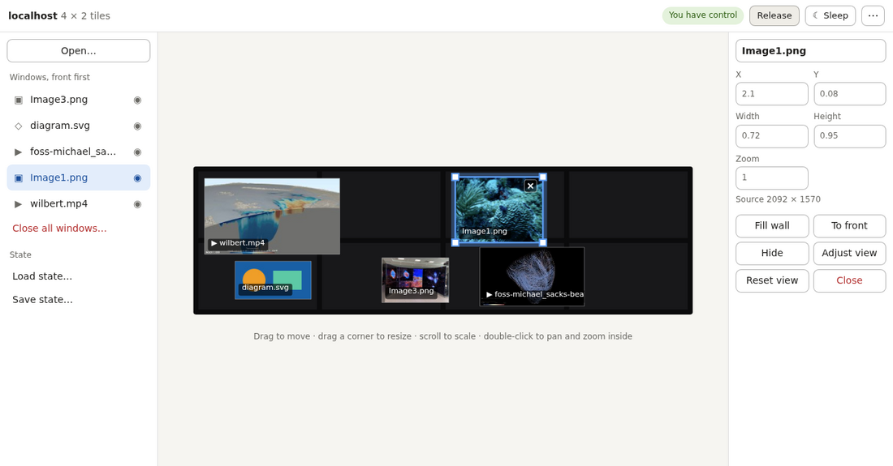

# DisplayCluster

DisplayCluster drives a tiled display wall: many screens, on one computer or
across a cluster, used as one large canvas. People open images, movies and
drawings on it, move and resize them across the screens, save arrangements
and bring them back, and show their own screens or browser tabs live, from the
wall's console or from any browser, phone or script.

## What it does

- **Shows content at the wall's full resolution:** images in any format Qt
  reads, movies (decoded on NVIDIA GPUs where possible), SVG drawings, and
  gigapixel images as multi-resolution image pyramids. Lines stay straight
  across the bezels between screens.
- **Saves layouts.** A layout (a `.dcx` file) records which files are open and
  where, so a talk or an exhibit comes back with one click. A project's
  layouts can live in its folder with its media and move with it.
- **Shows a presenter's screen, live.** Two client programs stream to the
  wall, each as a window that can be moved and resized like any other:
  - **DesktopStreamer** sends a whole screen, or any rectangle of it, from
    Linux, macOS or Windows. It's a small Qt program that needs none of the
    wall's software.
  - **The Chrome extension** sends one browser tab, from Chrome or Edge, with
    nothing else to install: dashboards, web visualizations, online slides.
    It uses the same port and token as the web UI.
- **Is controlled from anywhere:**
  - **the control window**, a picture of the wall on the head node's screen;
  - **the web UI**, in any browser, which installs as an app on a phone or
    tablet;
  - **Python scripts**, with `DC.py`, a single file with no dependencies;
  - **anything that speaks HTTP**, through a JSON API with a token, over
    HTTPS when the wall has a certificate.
- **Responds to sensors.** Windows can be shown and hidden by light sensors,
  buttons or anything else that's on or off, for interactive exhibits.

## How it works

One MPI process, on the head node, runs the control window and serves the web
UI and API. One more process per display node (or per GPU) draws that node's
tiles, each reading content from a filesystem they all share. The wall's
layout is a JSON file listing its tiles and which host and X display draws
each. A wall can be a cluster of display nodes or a single machine with
several monitors.

It's built either as an apptainer container image, which the wall's machines
run with only apptainer, the NVIDIA driver and Open MPI installed, or natively
on Linux, macOS or Windows. A wall's files (the image or build, its scripts,
its layout, and its content) live in one directory that can sit anywhere.

## Documentation

| Read | For |
|---|---|
| [doc/quickstart.md](doc/quickstart.md) | setting up a wall: building, installing, starting it, the web UI, and client machines, in two pages |
| [doc/cheatsheet.md](doc/cheatsheet.md) | people using a wall that's running: starting it at the console, the control window, the web UI, showing files and screens, saving layouts |
| [doc/setup.md](doc/setup.md) | the full guide: both builds on every platform, preparing the display nodes, the configuration file, running it unattended, DesktopStreamer, troubleshooting |
| [doc/remote-control.md](doc/remote-control.md) | the web UI, phones, the Chrome extension, `DC.py`, sensors, and the API |
| [doc/content.md](doc/content.md) | where content can live, how layouts refer to it, and the tools that gather and repair layouts |

## Building, in brief

- **A wall (container):** on a Linux machine with Docker and apptainer,
  `./build-sif.sh -r /shared/DisplayCluster` builds the image into the wall's
  directory ([Container build](doc/setup.md#container-build)).
- **Native:** CMake, with Qt 6, Boost, Open MPI, FFmpeg and libjpeg-turbo, and
  optionally CUDA for movie decode; on Windows, through vcpkg
  ([Native build](doc/setup.md#native-build)).
- **Client tools only:** `-DDISPLAYCLUSTER_CLIENT_ONLY=ON` builds DesktopStreamer
  and installs it with `DC.py` and the Chrome extension, with none of the
  wall's dependencies ([DesktopStreamer](doc/setup.md#desktopstreamer)).

## Licence

BSD-style; see [LICENSE](LICENSE). Copyright The University of Texas at
Austin. Questions and problems:
[GitHub issues](https://github.com/TACC/DisplayCluster/issues).
